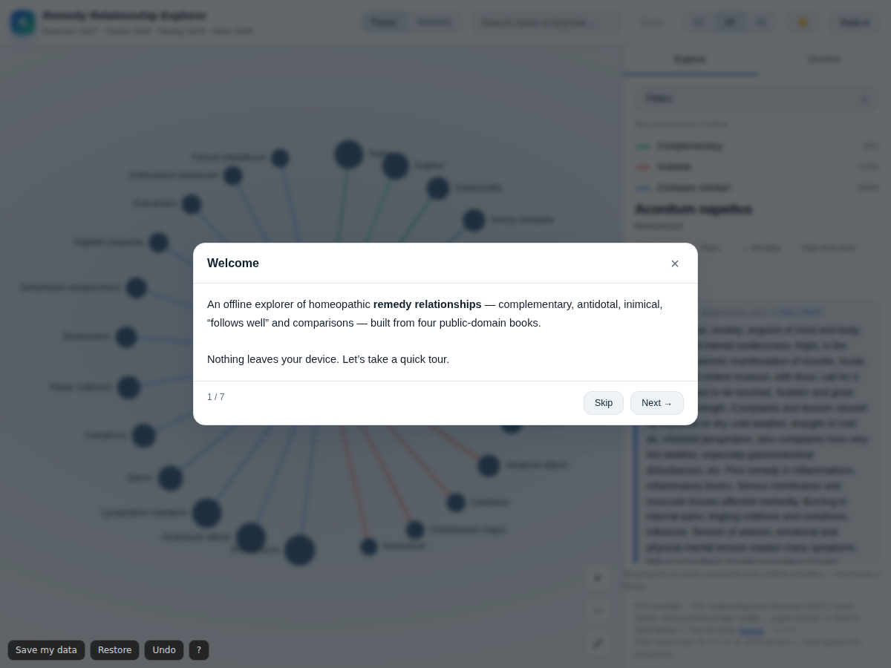

# Remedy Relationship Explorer

<!-- shot:start -->

<!-- shot:end -->

**An offline, single-file explorer for homeopathic remedy relationships — built from public-domain literature.**

[**▶ Open the live demo**](https://drsamonline.github.io/remedy-relationship-explorer/app.html) &nbsp;·&nbsp;
[Landing page](https://drsamonline.github.io/remedy-relationship-explorer/) &nbsp;·&nbsp;
[Report an issue](https://github.com/drsamonline/remedy-relationship-explorer/issues)

---

## ⬇ Download

| Platform | File | Link |
|---|---|---|
| **Windows** | `.exe` (installer) · `.msi` | [Download](https://github.com/drsamonline/remedy-relationship-explorer/releases/latest) |
| **macOS** | `.dmg` | [Download](https://github.com/drsamonline/remedy-relationship-explorer/releases/latest) |
| **Linux** | `.AppImage` · `.deb` | [Download](https://github.com/drsamonline/remedy-relationship-explorer/releases/latest) |
| **Android** | `remedy-explorer.apk` | [Download](https://github.com/drsamonline/remedy-relationship-explorer/releases/latest) |
| **Any device** | single-file `app.html` | [Open / save](https://drsamonline.github.io/remedy-relationship-explorer/app.html) |
| **Installable PWA** | — | [Open the demo](https://drsamonline.github.io/remedy-relationship-explorer/app.html) → *Install app* |

All builds are produced automatically by GitHub Actions from the same single HTML file —
see [Releases](https://github.com/drsamonline/remedy-relationship-explorer/releases) and
[`docs/build.md`](docs/build.md).

## What it is

A study & reference tool for homeopathic **remedy relationships** — complementary, antidotal,
inimical, "follows well" and "compare" links — extracted from four public-domain materia medicas
and visualised as an interactive, zoomable graph.

It is **one self-contained HTML file**. No server, no backend, no API keys, no build step, no
network access. Open it and it works — on a laptop, a tablet, or a phone, online or off.

## Features

- **Focus view** — one remedy at a time, its relationships arranged in a ring, grouped and
  colour-coded by type. Click any remedy to re-centre; breadcrumbs retrace your path.
- **Network view** — the most-connected remedies as a force-directed graph, with a detail slider
  and collision-aware layout so nodes never overlap.
- **Search by name *or symptom*** — the full-text search scans keynotes too, so
  “burning itching worse heat” finds Sulphur, Oenanthe, Selenium and Fagopyrum.
- **Full keynotes** for 652 remedies, each labelled with its source — read the complete passage in a
  built-in reader (⤢ Full text), not a truncated snippet.
- **Filters** — by relationship type, by kingdom (mineral / plant / animal / nosode), by source
  book, and a **“corroborated only”** toggle that keeps just the relationships confirmed by two
  or more books.
- **Provenance** — every relationship carries a superscript showing its source: **B** Boericke,
  **C** Clarke, **H** Hering, **A** Allen.
- **Hover or tap a node** for a short remedy card (keynotes included); open the full text in the reader.
- **Minimap**, **curved edges** and **animated transitions** for the network view.
- **Query expressions** — ask things like *“inimical to Lachesis and complementary to Sulphur”*.
- **Compare two remedies** — shared vs exclusive relationships and a Jaccard overlap score.
- **Colour by** relationship type, kingdom, community cluster or plant genus.
- **Flashcards** and three quiz modes for revision.
- **Shortest path** between any two remedies.
- **Quiz mode**, **study notebook** (export your starred remedies + notes as Markdown),
  **copy to clipboard**, **PNG export**, **printable remedy sheet**.
- **Deep-linkable URLs**, keyboard shortcuts, screen-reader support, system-aware light/dark,
  a high-contrast theme, adjustable text size, and a **colour-blind-safe palette** with dashed edge patterns.
- **Export/import all your data** (shortlist, notes, preferences) as a single JSON file.
- **Fully responsive** — phone, tablet, and large desktop.
- **In-app Help** (Tools → Help, or press <kbd>?</kbd>) and a **7-step guided tutorial** that runs on first
  visit — covering search, views, keynotes, shortlist/export and sources.

## Data

| | |
|---|---|
| Remedies | **686** |
| Relationships | **7,786** |
| Corroborated by ≥2 books | **928** |
| Keynotes | **653** |
| Kingdoms classified | 682 / 685 |

| Source | Author | Year | Licence |
|---|---|---|---|
| Pocket Manual of Homoeopathic Materia Medica | William Boericke | 1927 | Public domain |
| Dictionary of Practical Materia Medica | John Henry Clarke | 1900 | Public domain |
| Guiding Symptoms of Our Materia Medica | Constantine Hering | 1879 | Public domain |
| Keynotes and Characteristics with Comparisons | Henry C. Allen | 1898 | Public domain |

Relationships were parsed from each book's **“Relations”** sections (OCR), resolved against a
remedy-name vocabulary, merged across sources and cross-referenced. See
[`docs/data.md`](docs/data.md) for the full method.

> **Not medical advice.** The data is OCR-derived from historical texts and may contain errors.
> Always verify against the printed sources. For study and reference only.

## Offline by design

The application has **no server, no backend and no network dependency**. That is a design
constraint, not a limitation — see [`docs/offline.md`](docs/offline.md).

## Get it

| Format | How |
|---|---|
| **Single file** | Download [`app.html`](app.html) and open it. That's it. |
| **Live demo** | <https://drsamonline.github.io/remedy-relationship-explorer/app.html> |
| **Installable PWA** | Open the live demo in Chrome/Edge → *Install app*. Works offline afterwards. |
| **Windows (.exe)** | Built by CI — see [Releases](https://github.com/drsamonline/remedy-relationship-explorer/releases). |
| **Android (.apk)** | Built by CI — see [Releases](https://github.com/drsamonline/remedy-relationship-explorer/releases). |

Desktop and Android builds are produced automatically by GitHub Actions from the same single
HTML file (Tauri for Windows, Capacitor for Android). See [`docs/build.md`](docs/build.md).

## Licence

PolyForm Noncommercial 1.0.0 — free for any noncommercial purpose. Commercial use
needs a licence from the author. See [`LICENSE`](LICENSE).

Educational institutions may obtain a free or discounted commercial licence on
request. Full terms: [`LICENSE`](LICENSE) · FAQ: [`docs/licensing.md`](docs/licensing.md).

## Author

**Dr Sohil Momin** — homeopath · Vadodara, Gujarat, India
[sohilmomin2000@gmail.com](mailto:sohilmomin2000@gmail.com) · [@drsamonline](https://github.com/drsamonline)

Built with care, and no dependencies.

---

## Built with Forge

This repo is a **Forge** app and adopts the shared kits.

- **Shared build workflow** — `.github/workflows/build-apps.yml` calls the reusable
  build in [`drsamonline/app-builder`](https://github.com/drsamonline/app-builder).
  On every push to `main` it builds a portable Windows **EXE** and a signed
  Android **APK** and attaches them to the `app-latest` release, so these URLs
  always track the newest build:

  - `https://github.com/drsamonline/remedy-relationship-explorer/releases/latest/download/remedy-relationship-explorer-portable.exe`
  - `https://github.com/drsamonline/remedy-relationship-explorer/releases/latest/download/remedy-relationship-explorer.apk`

Built with [Forge](https://github.com/drsamonline/forge) by Dr Sohil Momin.
